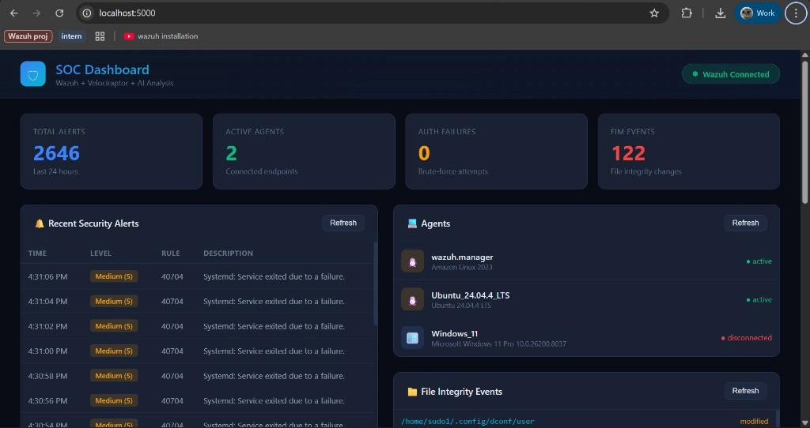
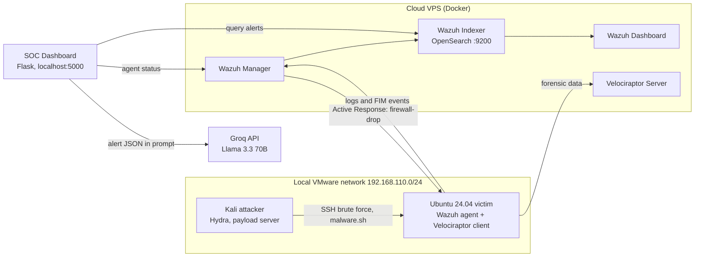
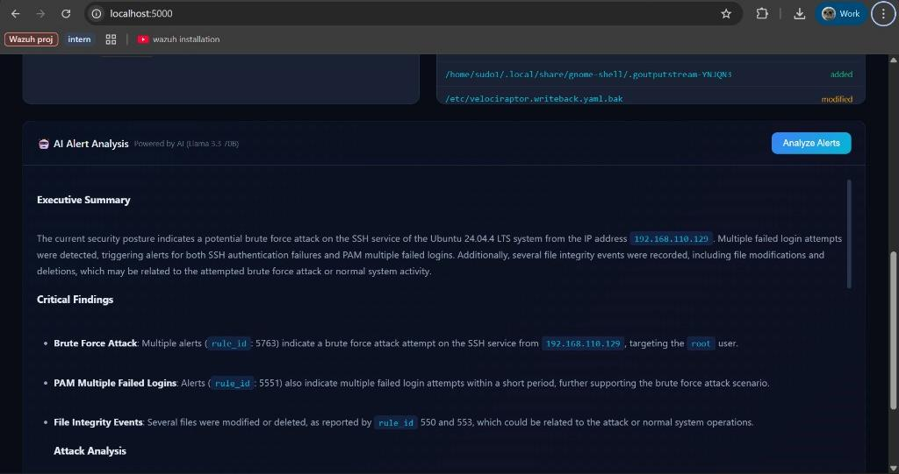
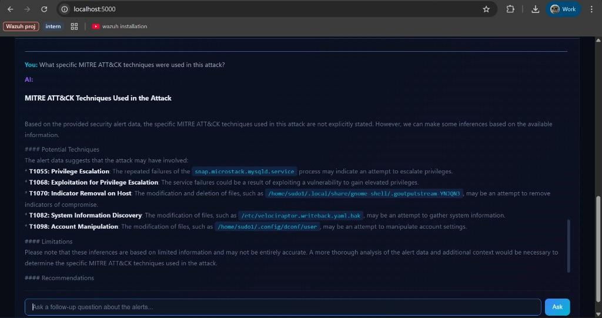

# SOC Threat Detection and Investigation using Wazuh, Velociraptor, and AI-assisted Alert Analysis

Bachelor thesis project (USTH, 2026). A small Security Operations Center lab built only from free, open-source tools, plus a Flask dashboard that sends Wazuh alerts to an LLM (Llama 3.3 70B via Groq) for summaries, MITRE ATT&CK mapping and remediation suggestions.

The full write-up is in the PDF at the repository root. This README covers what was built, how to run the dashboard, and what the results do and do not show.



## What it does

| Layer | Tool | Role in the lab |
|---|---|---|
| Detection | Wazuh 4.14.4 (Docker, single node) | Log collection, correlation rules, File Integrity Monitoring (FIM), Active Response |
| Investigation | Velociraptor 0.72 | Remote artifact collection on the compromised endpoint (login history, process list, bash history, live shell) |
| AI triage | `soc-dashboard/` (Flask + Groq) | Pulls alerts from the Wazuh Indexer, builds a prompt, returns an analyst-style assessment with follow-up Q&A |

## Architecture



## Attack scenarios tested

1. **SSH brute force** with Hydra (`rockyou.txt`, user `root`) from the Kali VM. Wazuh rules 5551, 5710 and 5763 fired (MITRE T1110, T1110.001, T1078). Active Response added an iptables DROP rule for the attacker for 600 seconds; a second Hydra run then got connection errors instead of "Failed password".
2. **File Integrity Monitoring** on `/home` (60-second scan interval, lab setting): file create, modify and delete were all reported (rules 554, 550, 553).
3. **Post-compromise malware simulation**: a script downloaded over HTTP (T1105), collected host info (T1592) and appended a reverse-shell line to `~/.bashrc` (T1546.004). FIM flagged the new file and the `.bashrc` change.
4. **Forensics with Velociraptor**: `Linux.Sys.LastUserLogin` (39 rows), `Linux.Sys.Pslist` (369 processes), `Linux.Sys.BashHistory` (143 entries) and a live shell `tail` of `.bashrc` confirmed the persistence line.

## AI-assisted alert analysis

The dashboard (`soc-dashboard/app.py`) queries the Wazuh Indexer over its REST API, takes the 15 highest-severity alerts and 10 FIM events from the last 7 days, wraps them in a SOC-analyst prompt and sends it to `llama-3.3-70b-versatile` on Groq (temperature 0.3). The output is an executive summary, critical findings, per-attack breakdown with ATT&CK techniques, a file-integrity assessment and recommendations. A chat box lets the analyst ask follow-up questions over the same data.



## Results and limitations

What worked: the model identified the SSH brute force from the correct source IP against the `root` account, linked rules 5763 and 5551, mapped it to T1110, and produced reasonable generic recommendations (rate limiting, key-based auth, MFA).

What to be careful about, based on the single run documented in the thesis:

- **One run, no metrics.** There is no precision/recall, no comparison with manual triage and no triage-time measurement. The results show the pipeline works end to end, not that the AI is accurate.
- **Incomplete coverage.** The executive summary did not single out the `malware.sh` drop or the `.bashrc` persistence change; it listed unrelated GNOME and Velociraptor file changes instead.
- **Weakly supported follow-up answer.** When asked for ATT&CK techniques, the model said they were "not explicitly stated" and then still listed T1055, T1068, T1070, T1082 and T1098 from noisy service-failure and file-change events.

Treat the LLM output as a first-pass summary for a human analyst, not as a verdict. Obvious next steps: a repeatable evaluation over labelled scenarios, enrichment with threat-intel feeds, and Windows/Sysmon coverage (the Windows agent in the lab was disconnected).



## Run the dashboard

Requirements: Python 3.10+, a reachable Wazuh Indexer and Wazuh API, and a [Groq API key](https://console.groq.com/).

```bash
cd soc-dashboard
python -m venv .venv && source .venv/bin/activate   # Windows: .venv\Scripts\activate
pip install -r requirements.txt
cp .env.example .env                                # then edit .env
python app.py                                       # http://127.0.0.1:5000
```

The app refuses to start if the Wazuh/Indexer settings are missing. All settings are documented in `soc-dashboard/.env.example`.

## Security notes

The dashboard was hardened after the thesis was submitted:

- No credentials, server addresses or API keys in the code; everything comes from `.env` (git-ignored).
- TLS certificates are verified by default. Wazuh ships self-signed certificates, so set `CA_BUNDLE` to your root CA, or `VERIFY_TLS=false` for a throwaway lab only.
- Listens on `127.0.0.1` by default. Binding to any other address requires `DASHBOARD_PASS` (HTTP Basic auth), otherwise the app exits. The Flask debugger is off unless `FLASK_DEBUG=true` and is never enabled on a non-loopback address.
- All alert fields shown in the UI are HTML-escaped, and LLM output is escaped before Markdown rendering. Log lines, usernames and file paths are attacker-controlled, so rendering them raw would allow script injection into the analyst's browser.
- Alert data is passed to the model inside `<alerts>` tags with an instruction to treat it as untrusted data, which reduces (but does not eliminate) prompt injection from log content.
- Alert data is sent to a third-party API (Groq). Do not point this at logs you are not allowed to share externally.

The Wazuh stack in the lab was a throwaway VPS. If you deploy something similar, change all default Wazuh credentials, restrict ports 9200, 55000 and the Velociraptor GUI to your own IP, and never expose them to the whole internet.

## Repository layout

```
.
├── README.md
├── SOC Threat Detection and Investigation using ... .pdf   # full thesis
├── docs/images/                                           # screenshots used above
└── soc-dashboard/
    ├── app.py                # Flask backend: Wazuh/Indexer queries, Groq calls
    ├── templates/index.html  # dashboard UI
    ├── requirements.txt
    └── .env.example
```

## Tools

[Wazuh](https://wazuh.com/) · [Velociraptor](https://docs.velociraptor.app/) · [Hydra](https://github.com/vanhauser-thc/thc-hydra) · [MITRE ATT&CK](https://attack.mitre.org/) · [Groq](https://groq.com/) with Llama 3.3 70B · Flask · Docker · VMware Workstation
